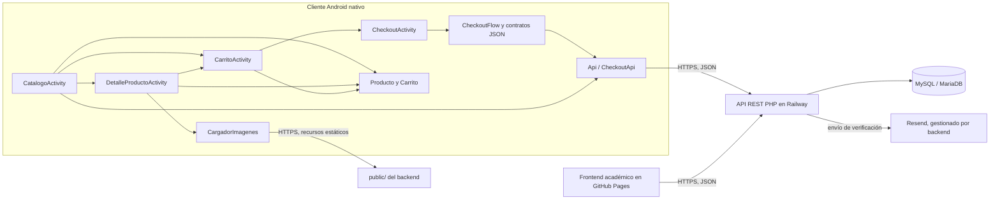

# Incancelables Android

**Trabajo Práctico Integrador N.º 2 — UPSO**  
**Tema:** aplicación móvil nativa para el MVP de e-commerce Incancelables.  
**Tecnologías:** Java, Android SDK, layouts XML y API REST sobre HTTPS.  
**Compatibilidad mínima declarada:** Android 6.0.1 (API 23).  
**Fecha de entrega indicada en la consigna:** 24 de noviembre de 2026, 23:59.

> **Datos académicos por completar antes de entregar:** grupo e integrantes, URL definitiva del repositorio Android, enlace al video de demostración y ubicación de la APK de depuración. No se consignan aquí porque no están definidos en los archivos del proyecto inspeccionados.

## Presentación

Incancelables Android es un cliente móvil nativo del MVP académico de comercio electrónico de Incancelables. Permite consultar el catálogo publicado por el backend, seleccionar productos, armar un carrito local e iniciar el checkout como invitado. La aplicación está escrita en Java y usa pantallas Android nativas; no es una WebView del sitio.

La app comparte las reglas y la API REST del e-commerce académico con la tienda web. El backend mantiene la autoridad sobre precios, disponibilidad, estados de pedido y procesamiento del pago simulado.

| Recurso | URL |
| --- | --- |
| API académica — catálogo | <https://incancelables-ecommerce-academico-production.up.railway.app/api/productos> |
| Tienda web académica | <https://xb3nderx.github.io/incancelables-frontend-academico/pages/tienda.html> |
| Repositorio backend | <https://github.com/xb3nderx/incancelables-ecommerce-academico> |
| Repositorio frontend | <https://github.com/xb3nderx/incancelables-frontend-academico> |
| Repositorio Android | Pendiente de confirmar/publicar |

## Alcance del MVP móvil

La implementación inspeccionada incluye:

- Consulta HTTPS del catálogo y presentación de estados de carga, lista vacía, error y reintento.
- Navegación nativa entre catálogo, detalle, carrito y checkout.
- Carrito temporal en memoria, con cantidades, límites de disponibilidad, subtotales y total.
- Creación de pedidos de checkout invitado y tratamiento de correcciones comerciales y errores de red/servidor.
- Ingreso en la app del código de seis dígitos recibido por correo, validación, recuperación del pedido y pago simulado.
- Presentación de imágenes del producto en el detalle cuando el catálogo incluye URLs HTTPS; ante su ausencia o fallo se usa un placeholder.

No se implementaron cuentas de usuario, autenticación de clientes ni una pasarela de pago real. La solicitud de pago de esta implementación indica el proveedor `DUMMY` y la simulación `APROBADO`; el backend puede marcar el pedido pagado y afectar el stock. No debe confundirse este flujo con un cobro real.

## Arquitectura



Las Activities presentan la interfaz; `Producto` y `Carrito` mantienen los datos de catálogo y selección. `Api` consulta el catálogo de forma asíncrona y conserva su resultado en memoria. `CheckoutFlow` coordina estados y reglas de pantalla, `CheckoutRequest`/`CheckoutResponse` componen e interpretan JSON y `CheckoutApi` realiza el transporte HTTP en un ejecutor de trabajo, entregando el resultado al hilo principal. `CargadorImagenes` descarga recursos HTTPS fuera del hilo de interfaz, con caché de memoria, deduplicación de solicitudes y placeholder.

## Tecnologías y decisiones técnicas

- **Java** para la lógica y **XML** para las interfaces, con Activities e Intents explícitos.
- **AndroidX AppCompat**, Material Components y RecyclerView; no se usan Retrofit, OkHttp, Gson ni SDK de Firebase.
- **`HttpURLConnection`**, `org.json`, `ExecutorService` y `Handler` para las operaciones REST sin bloquear el hilo principal.
- Una única URL base de API en `Api.URL_BASE`; no hay credenciales en el código.
- HTTPS obligatorio en el manifiesto (`usesCleartextTraffic="false"`). `SslConfianza` agrega raíces públicas ISRG X1/X2 al almacén del sistema para compatibilidad con dispositivos API 23 y deja intacta la verificación del nombre de host.
- La interfaz sigue la paleta del frontend académico (fondos oscuros, tarjetas claras y acento naranja) adaptada a pantallas móviles. Los textos de interfaz residen en `strings.xml`.
- El catálogo puede incluir una lista opcional `imagenes` con URL, texto alternativo y orden. El detalle la presenta como galería; las imágenes no se descargan en el hilo principal.

## Pantallas

| Activity | Función implementada |
| --- | --- |
| `CatalogoActivity` | Consulta y muestra productos, disponibilidad y acciones para abrir detalle, agregar una unidad o abrir el carrito. Incluye carga, vacío, error y reintento. |
| `DetalleProductoActivity` | Recibe datos del producto mediante extras de Intent, muestra descripción, precio, disponibilidad y galería opcional; permite agregar una unidad. No realiza una consulta de detalle al backend. |
| `CarritoActivity` | Lista las selecciones, permite aumentar/disminuir cantidades o eliminar líneas, muestra subtotales y total y continúa al checkout. |
| `CheckoutActivity` | Presenta resumen y datos de comprador; administra creación del pedido, ingreso/reenvío/validación del código, revisión de cambios comerciales y estados del pago. No es una pantalla separada de estado de pedido. |

## Flujo de compra

1. La app solicita el catálogo y muestra los productos disponibles.
2. El usuario abre el detalle mediante Intent con datos del producto en extras, o agrega directamente una unidad desde el catálogo.
3. El carrito permite modificar cantidades dentro de la disponibilidad conocida. El carrito no reserva stock y permanece en memoria del proceso.
4. En checkout se completan nombre, apellido y email. La app valida los datos antes del envío y presenta el resumen.
5. Se crea el pedido en el backend. Si el backend devuelve una corrección comercial, la app muestra las diferencias y solo actualiza el carrito tras la acción explícita del usuario.
6. El backend envía un código de seis dígitos al email. El usuario lo ingresa en Android; la app solicita su validación y luego recupera los pedidos autorizados.
7. Cuando el pedido se puede pagar, la app solicita el pago simulado. Presenta el resultado informado por el backend y refresca el catálogo cuando corresponde.

La app bloquea pulsaciones duplicadas mientras mantiene una operación en curso y no reintenta automáticamente solicitudes POST con resultado incierto. No existe sincronización de un carrito persistente entre instalaciones o dispositivos.

## Endpoints REST consumidos

La raíz configurada en `Api.URL_BASE` es:

```text
https://incancelables-ecommerce-academico-production.up.railway.app/api
```

| Método y ruta | Uso en la app |
| --- | --- |
| `GET /productos` | Carga y refresco del catálogo. |
| `POST /pedidos` | Crear pedido con nombre, apellido, email, líneas y canal `android`. |
| `POST /email-verificaciones/codigo` | Solicitar el reenvío del código para un pedido. |
| `POST /email-verificaciones/validar-codigo` | Validar el código de seis dígitos. |
| `POST /email-verificaciones/pedidos` | Recuperar pedidos asociados a la verificación confirmada. |
| `POST /email-verificaciones/pedidos/reemplazo` | Reemplazar el pedido cuando el usuario acepta una corrección y cambia sus líneas. |
| `POST /pedidos/{id}/pago` | Iniciar el pago simulado del pedido. |

El catálogo de detalle no tiene un endpoint propio: los datos se pasan por Intent. Aunque `CheckoutRequest` contiene un constructor para cancelación, la aplicación no lo invoca y no presenta una acción para cancelar pedidos. Tampoco se consume `GET /productos/{id}`.

## Servicios externos y relación con el sistema

- **Railway:** aloja la API académica PHP/Apache; el backend usa MySQL/MariaDB. Android accede a la API y a las imágenes públicas por HTTPS.
- **Resend:** servicio de correo utilizado por el backend para enviar códigos de verificación. Android no integra el SDK ni llama directamente a Resend.
- **GitHub Pages:** publica el frontend web académico; es otro cliente de la API, no una dependencia de ejecución de la app Android.
- **Servicio cloud adicional en Android (TP2 R4): no implementado en el código inspeccionado.** No hay Firebase Authentication, Firestore, FCM, Storage ni otra integración cloud de la app. El backend Railway por sí solo no satisface el requisito de un servicio cloud adicional. Este requisito debe resolverse y demostrarse antes de considerar completa la entrega.

No se requiere `google-services.json` para la configuración actual porque no se detectó un SDK de Google Services/Firebase en las dependencias o el código. Si se incorpora un servicio cloud, habrá que documentar su configuración y, si corresponde, sus reglas de producción sin publicar claves privadas.

## Estructura del proyecto

```text
IncancelablesAndroid/
├── app/
│   ├── build.gradle.kts
│   └── src/
│       ├── main/
│       │   ├── AndroidManifest.xml
│       │   ├── java/com/incancelables/android/
│       │   │   ├── Activities, adapters y layouts de catálogo/detalle/carrito/checkout
│       │   │   ├── Api.java, CheckoutApi.java y CheckoutFlow.java
│       │   │   ├── CheckoutRequest.java y CheckoutResponse.java
│       │   │   ├── Producto.java, Carrito.java y SslConfianza.java
│       │   │   └── CargadorImagenes.java
│       │   ├── res/layout/       # Vistas XML
│       │   ├── res/values/       # Colores, tema y textos
│       │   └── res/raw/          # Raíces públicas ISRG X1/X2
│       ├── test/                 # Pruebas JVM
│       └── androidTest/          # Pruebas instrumentadas
├── gradle/libs.versions.toml     # Versiones de plugins y dependencias
├── gradle/wrapper/               # Gradle Wrapper
├── build.gradle.kts
└── settings.gradle.kts
```

## Instalación y ejecución

### Requisitos

- Android Studio con Android SDK Platform 35 y Build Tools compatibles.
- JDK compatible con Android Gradle Plugin 8.7.3; el entorno local registrado en el checkpoint utiliza JDK 21.
- Para compatibilidad mínima: dispositivo o emulador Android 6.0.1/API 23 o posterior.
- Acceso a Internet para consultar el backend e imágenes HTTPS.

### Configuración

1. Abrir `IncancelablesAndroid/` en Android Studio como proyecto Gradle.
2. Verificar `app/src/main/java/com/incancelables/android/Api.java`. `URL_BASE` apunta al backend académico publicado. Para otro entorno se cambia allí la única constante de URL base; no agregar secretos.
3. Sincronizar Gradle y seleccionar un dispositivo Android API 23 o superior.
4. Ejecutar la configuración `app` desde Android Studio. Para instalar el APK generado, usar la variante `debug`.

La aplicación requiere permiso `INTERNET`. No habilita tráfico HTTP sin cifrar. El repositorio del backend ofrece instrucciones separadas para levantar el servicio localmente; cambiar la URL Android a una dirección local solo funciona si el dispositivo puede alcanzar ese servidor.

### Comandos habituales

Desde la raíz del proyecto:

```bat
gradlew.bat assembleDebug
gradlew.bat testDebugUnitTest
gradlew.bat connectedDebugAndroidTest
```

La APK de depuración se genera normalmente en `app/build/outputs/apk/debug/app-debug.apk`. Estos comandos se documentan como instrucciones; no se ejecutaron al preparar este README.

## Compatibilidad y pruebas

`minSdk` está configurado en **23**, correspondiente a Android 6.0.1, y `compileSdk`/`targetSdk` en 35. El checkpoint del proyecto registra pruebas en un Samsung Galaxy J2 Prime SM-G532M con Android 6.0.1/API 23.

El código contiene pruebas JVM para modelo y carrito, y pruebas instrumentadas para API/catálogo, checkout, imágenes y respuestas. En los resultados locales ya existentes se observan:

- **5 pruebas JVM aprobadas**, en los resultados de `ProductoTest` y `CarritoTest` del 9/11/2026.
- Un archivo de resultados de dispositivo con **18 pruebas instrumentadas aprobadas**, ejecutadas en `SM-G532M - 6.0.1` el 8/11/2026.

Estos son resultados registrados antes de la preparación del documento; no se volvieron a ejecutar. No se ejecutó Gradle para esta tarea. La validación final de entrega debe repetir las pruebas con el código vigente y conservar el resultado de compilación e instrumentación.

## Limitaciones conocidas y pendientes

- **TP2 R4 pendiente:** la app no integra todavía el servicio cloud adicional requerido por la consigna.
- **Cancelación no expuesta:** existe soporte de construcción de la solicitud en el cliente de contratos, pero no está conectado al flujo ni a la interfaz.
- **Carrito temporal:** se conserva en memoria del proceso; no persiste tras cierre forzado o muerte del proceso.
- **Checkout y recreación:** la rotación mantiene el flujo de checkout; una muerte del proceso no conserva el token de verificación en almacenamiento persistente. Un resultado incierto de una mutación no se reenvía automáticamente.
- **Pago académico:** el cliente usa el proveedor simulado `DUMMY` con resultado `APROBADO`; no cobra dinero, pero el backend puede registrar el pedido como pagado y descontar stock. Las pruebas o demostraciones contra el backend publicado pueden producir efectos en su base de datos.
- **Sin cuentas ni gestión:** no hay autenticación, perfil de usuario, administración de catálogo ni historial de compras.
- **Disponibilidad:** el valor mostrado proviene de la API y no constituye una reserva; el backend vuelve a validar el pedido.
- **Entrega por completar:** falta confirmar los datos del grupo, URL del repositorio Android, enlace del video y APK final. Debe agregarse evidencia de aportes si corresponde a la modalidad presentada.

## Requisitos académicos y estado documental

| Requisito TP2 | Situación observada |
| --- | --- |
| R1 — Java nativo, pantallas e Intents/extras | Cuatro Activities declaradas; catálogo abre detalle con extras. |
| R2 — API HTTPS, GET/POST y operación adicional | GET catálogo y varios POST de checkout; reemplazo y pago modifican el flujo del pedido. |
| R3 — validación y errores | Validaciones locales, respuestas HTTP y estados de red/corrección implementados; pruebas documentadas arriba. |
| R4 — servicio cloud adicional | **Pendiente; no hay integración adicional en la app.** |
| R5 — XML, textos y espera | Layouts XML, textos en `strings.xml`, lista y estados de carga. |
| R6 — rotación y navegación | Se conserva estado de Activities durante recreación; carrito sigue siendo de memoria y la muerte del proceso tiene las limitaciones indicadas. |
| R7 — URL centralizada y ausencia de secretos | URL base única en `Api.URL_BASE`; no se encontraron credenciales cloud. |
| R8 — API y web por HTTPS | URLs académicas documentadas en la sección Presentación. |
| R9 — README, APK y video | README preparado; APK/video finales deben adjuntarse y confirmarse. |
| R10 — evidencia de participación | Completar integrantes y aportes según la modalidad del grupo; no se encontró metadata Git del proyecto en esta carpeta. |

Esta tabla describe lo observado en código y artefactos locales; no sustituye la aceptación docente ni la comprobación final de cada requisito oficial.

## Repositorios relacionados

- **Backend académico — TP Integrador N.º 1:** [incancelables-ecommerce-academico](https://github.com/xb3nderx/incancelables-ecommerce-academico). API REST PHP y base de datos del MVP.
- **Frontend académico — TP Integrador N.º 1:** [incancelables-frontend-academico](https://github.com/xb3nderx/incancelables-frontend-academico). Tienda web que consume el mismo backend.
- **Android — TP Integrador N.º 2:** URL del repositorio pendiente de confirmación/publicación.

El README alojado actualmente en el repositorio frontend consultado presenta el contenido del README de e-commerce/backend. Para contratos y arquitectura del servidor se contrastó con el README local del backend; para Android prevalecen la consigna oficial y el código de esta aplicación.

## Conclusión

La aplicación ya ofrece un recorrido móvil nativo desde el catálogo hasta el pago simulado y reutiliza el backend académico compartido con la tienda web. La documentación distingue las funciones verificables de las brechas de entrega. En particular, la integración cloud adicional de R4, los datos de publicación/equipo y la evidencia final (APK y video) requieren confirmación antes de presentar el TP2 como completo.
